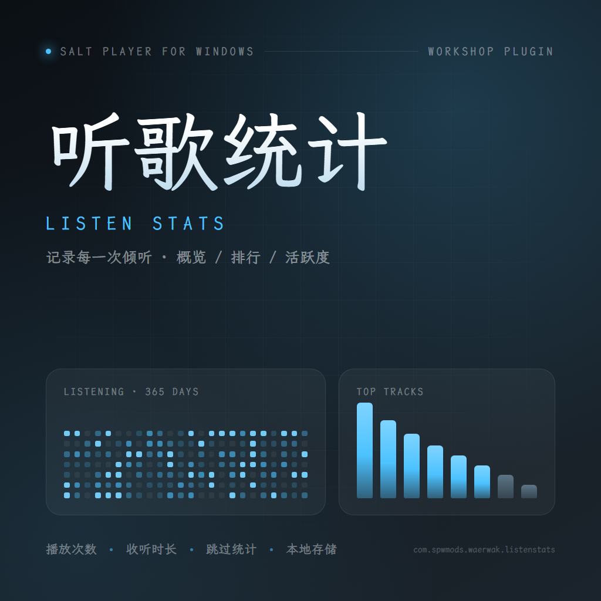
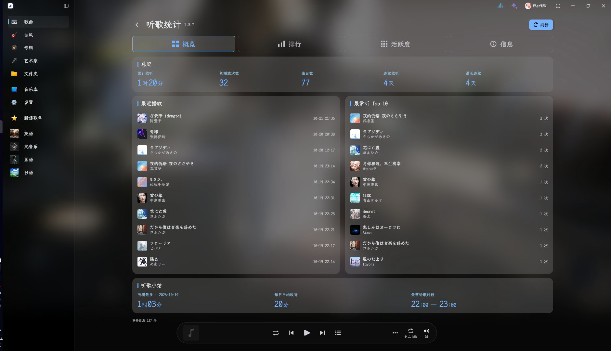
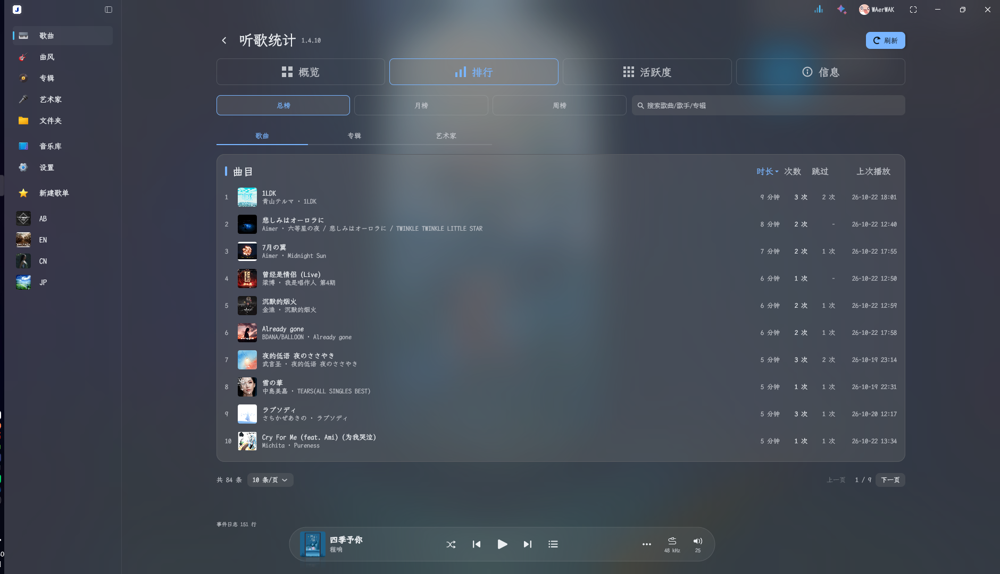
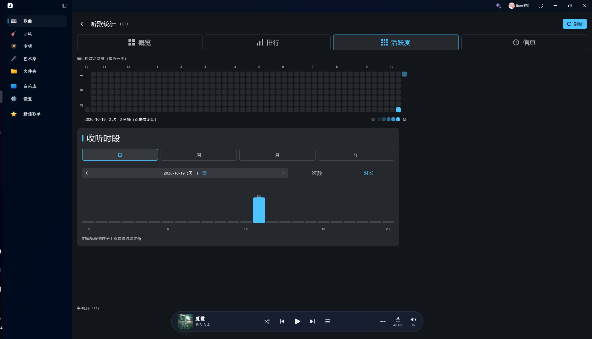
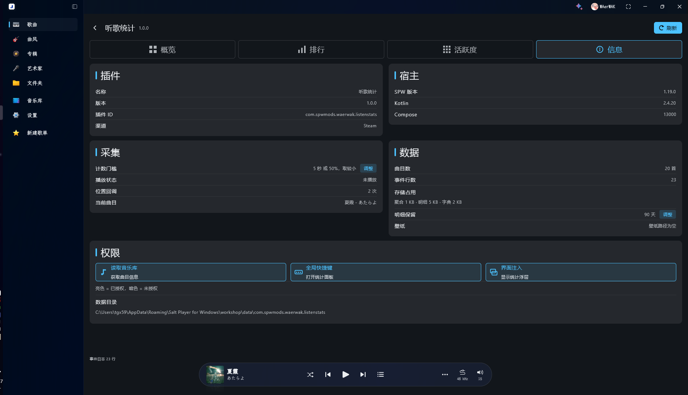
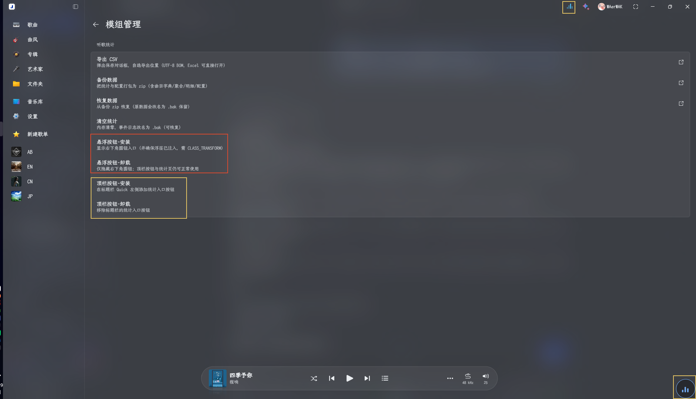

<p align="center">
  
</p>

<h1 align="center">听歌统计 · Salt Player for Windows 插件</h1>

<p align="center">
  
  
  
  
</p>

<p align="center">
  <a href="https://steamcommunity.com/sharedfiles/filedetails/?id=3822834646">Steam 创意工坊</a> ·
  <a href="https://github.com/WAerWAK/SPW-listen-stats">GitHub</a> ·
  <a href="CHANGELOG.md">更新日志</a>
</p>

<p align="center"><i>本插件 100% 由 AI 生成。</i></p>

记录你听了多少次、听了多久、什么时候听、最爱听什么。全部数据保存在本地，无网络请求。

---

## 界面

### 概览

累计收听时长、总播放次数、曲目数、连续收听与最长连续；「最近播放」与「最常听 Top 10」（含封面）；底部「听歌小结」显示听得最多的一天、每日平均收听、最常听歌时段。点击累计收听数值可在三种格式间循环（`12时05分` / `1天12时05分` / `1.50天`）。



### 排行

总榜 / 月榜 / 周榜 × 歌曲 / 专辑 / 艺术家 × 次数 / 时长 / 最近；列表显示封面与上次播放时间，**支持按歌曲 / 歌手 / 专辑搜索（含中文输入）**；点歌曲、专辑或艺术家都可以打开各自的详情弹窗（10 条/页，可调 10–50）。



### 活跃度

GitHub 风格年度热力图（可切换近一年 / 具体年份，悬浮显示当天详情，点击看明细），以及时长分布图（柱状 / 折线 / 曲线，今天 / 近 7 天 / 近 30 天 / 本月 / 本年 / 自定义，自动推断粒度，带纵轴刻度与平均线）。



### 信息

插件与宿主环境、采集状态、数据占用、权限状态、运行诊断；可调整计数门槛、明细保留天数、字体大小（0–60%）、内容宽度上限。



### 模组管理页

导出 CSV、备份 / 恢复、清空统计，以及悬浮按钮与顶栏按钮的安装 / 卸载。



---

## 功能说明

### 采集规则

- 一遍播放的边界：换曲、停止/结束、已计数后又回到开头
- 有效时长 = `min(位置增量, 墙钟增量)` —— 暂停、卡顿、拖进度条都不会虚增
- **计数门槛可自定义**：最少秒数 与「曲目时长 × 百分比」之间取较大 / 较小（默认 30 秒 / 50% / 取较小）
- 未达门槛的一遍记作「跳过」

### 数据存储（三层，体积可控）

| 层 | 位置 | 保留 |
|---|---|---|
| 曲目字典 | `tracks.jsonl` | 永久（每首歌一条元信息） |
| 按月聚合 | `daily/YYYY-MM.jsonl` | 永久（每次播放约 85 字节） |
| 原始明细 | `events/YYYY-MM-DD.jsonl` | 默认 90 天，可自定义；超期移到 `expired/` |

数据目录：`%APPDATA%\Salt Player for Windows\workshop\data\com.spwmods.waerwak.listenstats`

### 其他

- 两个入口：**右下角悬浮圆钮**（可拖动、贴边隐藏）与**标题栏按钮**（Quick 左侧），都可在模组管理页安装 / 卸载
- **字体与宿主同步**：自动使用 SPW 当前字体（内置 MiSans 或你自定义的字体）；字号可在信息页调节
- **背景跟随窗口材质**：隐藏宿主内容区，面板背景直接透出 Windows 亚克力 / 云母材质，无截图残影；经典主题下用纯色
- 点击左侧菜单切页、或点顶部标题栏按钮都不会误关面板；按 `Esc` 逐层退出（先关弹层，再关面板）
- 面板下沿留空，避开迷你播放条
- 跟随宿主深色/浅色主题；支持 SPW 壁纸背景
- 播放中数据自动刷新（活跃度页除外，需手动刷新以省性能）

---

## 安装

**方式一（推荐）**：在 [Steam 创意工坊订阅「听歌统计」](https://steamcommunity.com/sharedfiles/filedetails/?id=3822834646)。

**方式二**：下载 Release 里的 `.spmod`，放入
`%APPDATA%\Salt Player for Windows\workshop\plugins`，并在该目录的 `enabled.txt` 中加入插件 ID：

```
com.spwmods.waerwak.listenstats
```

首次启用需要在 SPW 的插件权限里允许 **读取音乐库 / 快捷键 / 界面注入**。

---

## 使用

1. 启动 SPW 后，右侧边缘会出现圆形浮钮（可拖动）
2. 也可以到 **设置 → 快捷键** 里给「打开听歌统计面板」绑定一个键位
3. 插件配置页（模组管理 → 听歌统计）提供：

| 按钮 | 作用 |
|---|---|
| 导出 CSV | 弹出保存对话框，导出曲目汇总表（UTF-8 BOM，Excel 可直接打开） |
| 备份数据 | 打包为 zip（字典 + 聚合 + 明细 + 配置 + 面板状态） |
| 恢复数据 | 先显示备份摘要，确认后从 zip 恢复（现有数据改名 `.bak` 保留） |
| 清空统计 | 内存清零，数据文件改名 `.bak`（可恢复） |
| 悬浮按钮-安装 / 卸载 | 显示 / 仅隐藏右下角圆钮（不影响顶栏按钮与面板） |
| 顶栏按钮-安装 / 卸载 | 添加 / 移除标题栏的统计入口 |

计数门槛、明细保留天数、字体大小、内容宽度上限在面板的「信息」页调整。

---

## 权限说明

| 权限 | 用途 |
|---|---|
| `library-read` | 读取曲目信息与封面图 |
| `class-transform` | 注入全屏统计面板 |
| `key-bindings` | 注册「打开面板」的全局快捷键（默认不绑定） |

**隐私**：所有统计与配置只写入上述本地目录，插件不发起任何网络请求。

---

## 已知限制

- 无云端同步，跨设备请用「备份数据 / 恢复数据」

---

## 构建

需要 JDK 21+ 与 Gradle 8.x。

1. 复制配置模板并按本机环境填写：
   ```bash
   cp gradle.properties.example gradle.properties
   ```
   把 `spwHostJar` 指向本机 SPW 安装目录下的 fat jar（Steam 版是 `app/ffmpeg-x64.dll`）。
2. 构建：
   ```bash
   gradle build
   ```
3. 产物：`build/libs/plugin-com.spwmods.waerwak.listenstats-<version>.spmod`

一键部署（开发用，会重启 SPW）：

```powershell
pwsh -File tools/deploy.ps1 -SpmodPath build/libs/plugin-com.spwmods.waerwak.listenstats-1.4.1.spmod
```

---

## 目录结构

```
src/main/kotlin/com/spwmods/waerwak/listenstats/
├── ListenStatsPlugin.kt        插件入口（启动/停止、快捷键、注入装配）
├── ListenStatsExtension.kt     播放扩展点（转发信号给采集层）
├── HostProbe.kt                宿主环境探测、数据目录定位、启动日志
├── OverlayInjection.kt         Hook 注入 + 全部面板 UI
├── stats/
│   ├── SessionTracker.kt       一遍播放状态机（次数/时长/跳过）
│   ├── StatsStore.kt           存储（按月聚合 + 明细 + 字典）与查询
│   ├── StatsModels.kt          数据模型
│   ├── CountRule.kt            计数门槛配置
│   ├── StorageRule.kt          明细保留天数配置
│   ├── LiveSessionStore.kt     崩溃恢复（10 秒落盘 + 幂等空标记）
│   ├── TrackDict.kt            曲目字典（hex key → 元信息）
│   ├── HeatmapScale.kt         热力图色阶
│   ├── RangeBuckets.kt         时长分布的时间范围与分桶
│   ├── GroupKeys.kt            艺术家拆分 / 专辑双键
│   └── JsonLite.kt             极简 JSON 读写
└── ui/
    ├── SaltDesign.kt           SaltUI 风格设计 token 与调色板
    ├── HostAppearance.kt       宿主深浅色同步、窗口材质判定
    ├── HostMaterialLayer.kt    材质桥接层（隐藏宿主内容）
    ├── HostFont.kt             宿主字体同步
    ├── HostWindow.kt           宿主主窗口定位
    ├── NavigationHook.kt       导航 / 返回键 hook
    ├── TitlebarButton.kt       标题栏入口按钮
    ├── CoverCache.kt           封面缩略图缓存（LRU + 128px 降采样）
    └── UiStateStore.kt         面板 UI 状态持久化
```

---

## License

Apache License 2.0 — see [LICENSE](LICENSE).
